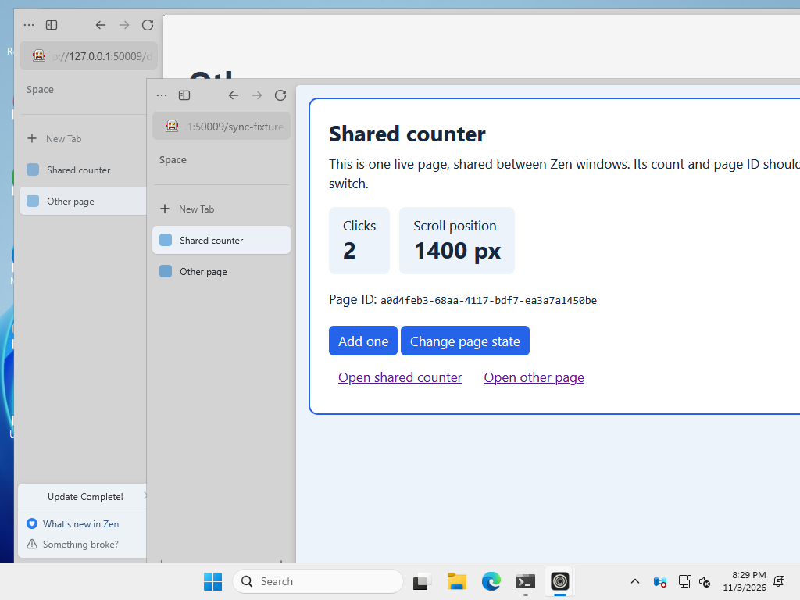
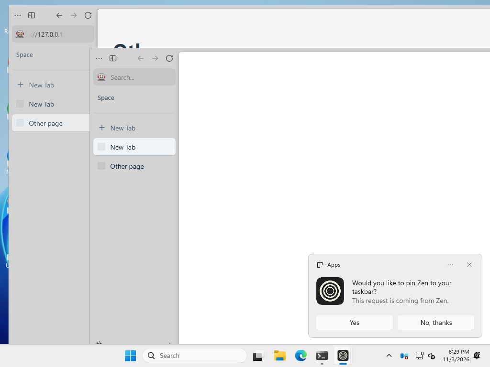

# Zen Windows sync canary

A small, independent regression check for **Zen Browser's synchronized tabs across windows**, running against actual released Windows builds on GitHub Actions.

**[Live release status](https://github.com/gakera/zen-window-sync-canary/issues/1)** · [Run a check](https://github.com/gakera/zen-window-sync-canary/actions/workflows/feasibility.yml)

## The problem

When you select a synchronized tab in another Zen window, its live page state should come with it. A counter, scroll position or navigation within a web app should survive the switch.

The regression checked here leaves the corresponding tab blank in the second window, sometimes labelled **New Tab**, even though the page loaded and worked in the first. The project was motivated by the window-sync reports in [zen-browser/desktop#14759](https://github.com/zen-browser/desktop/issues/14759); this controlled example does not establish that every report has the same underlying cause.

## What the check does

1. Open a shared counter page **once**, by following a link in window A.
2. Change its counter, scroll position and page history, then select another tab in A.
3. Select that same synchronized tab in window B and check that its content and live state survived.
4. Click the counter in B, then return to A and check the updated state again.

The test matches Zen's shared tab identifier and checks a per-document page ID, so it can detect a blank page or a fresh reload as well as lost state.

## Demonstrated results

| Working — Zen 1.21.8b | Failing — Zen 1.24b |
| --- | --- |
|  |  |

Window A is behind, on **Other page**. Window B is in front, with the corresponding shared tab selected. The working version shows **Shared counter**, its page ID and a count of **2** after a fresh click in B. The failing version shows an empty **New Tab** instead. Click either image for the full capture; [screenshot sources and verification](docs/screenshots.md) are recorded separately.

These two releases were checked with the same test revision on GitHub-hosted Windows runners:

| Zen release | Result | Evidence |
| --- | --- | --- |
| 1.21.8b | **PASS** — live state survives A → B → A | [Passing run](https://github.com/gakera/zen-window-sync-canary/actions/runs/41712798681) |
| 1.24b | **FAIL** — the matching tab in B stays blank | [Failing run](https://github.com/gakera/zen-window-sync-canary/actions/runs/41712794002) |

This is a focused regression signal, not a general security or update-safety certification. See the [live dashboard](https://github.com/gakera/zen-window-sync-canary/issues/1) for newer results.

## Following releases

New stable releases are checked daily at **06:17 UTC**. The dashboard distinguishes **PASS**, **FAIL**, and **UNVERIFIED** (automation or setup could not establish a result), with links to logs and screenshots. Subscribe to the dashboard issue for new test results, or use **Run workflow** to check a particular release manually.

## Further reading

- [Maintainer guide](docs/maintenance.md): running tests, monitoring, evidence and troubleshooting.
- [Development history](docs/development-history.md): the original feasibility investigation and debugging notes.

This project is independent of Zen Browser and tests release binaries rather than the in-tree Mochitest development suite.
